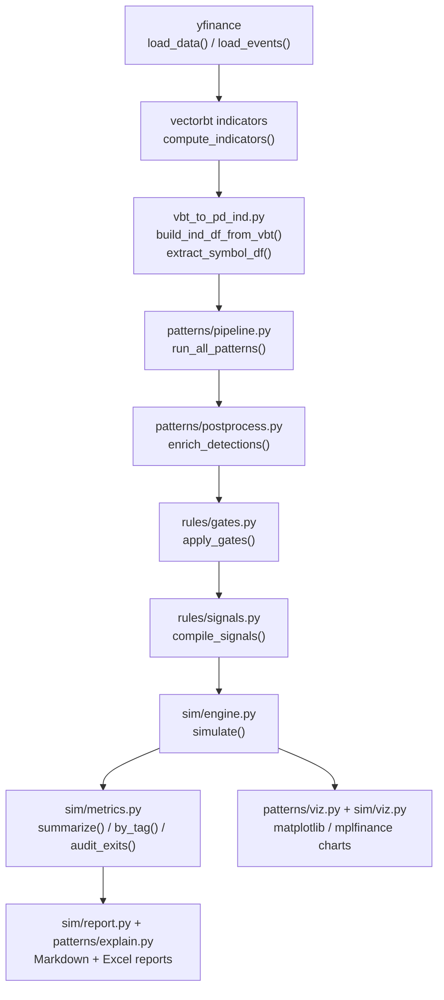

## Design summary

`vectorbt` is used **only** as an indicator-calculation library (RSI, MACD, Bollinger
Bands, moving averages, ATR). Everything downstream of that — pattern detection,
scoring, gating, signal compilation, the backtest engine itself, metrics, and the
audit step — is hand-written pandas/numpy code in `core/patterns/`, `core/rules/`,
and `core/sim/`. This is **not** `vectorbt.Portfolio.from_signals()`; the simulator
in `core/sim/engine.py` is a custom bar-by-bar event loop.

## End-to-end flow

Each arrow is a concrete Python call in `core/pipeline.py`'s `__main__` block — that
file **is** the reference wiring for the whole pipeline. The next page walks each
box in detail; [Extending the pipeline](/docs/technical/extending) covers how to
add new algorithms without breaking this chain.
